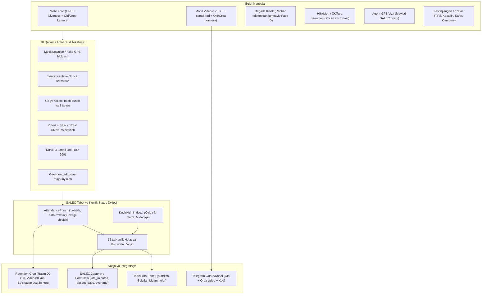

# SALEC uchun HR Hub Funksiyalari, Alohida Tabel Yon Paneli va Sozlamalar Guruhi Arxitekturasi

## 1. Maqsad va Arxitektura Tamoyili

SALEC (`d:/SALEC — копия`) loyihasida hozir «Табель» va «Рабочие дни» bo'limlari «Пользователи» menyusi ichida joylashgan hamda faqat Agent roli GPS vizit orqali tekshiriladi (qolgan rollar ish kunida avtomatik `worked` bo'lib ketadi). Ushbu reja orqali:

- Chap menyuda (Sidebar) «Пользователи» va «Зарплата» qatorida alohida **«Табель и посещаемость» (Tabel va davomat)** yon paneli (`{ kind: "tabel" }`) ochiladi.
- «Настройки» (`settingsSections`) ichida alohida **«Табель, Face ID и посещаемость»** sozlamalar guruhi shakllantiriladi.
- «Доступ» (RBAC) oynasida barcha davomat va tabel ruxsatlari `TABEL_GROUP_RU = "Табель и посещаемость"` ostida alohida guruh bo'lib ko'rinadi (mavjud `staff.tabel.*` va `staff.rabochie_dni.*` kalitlari buzilmaydi).
- HR Hub (`d:/hr-hub`) dagi mobil foto/video davomat, 3 xonali kunlik kod, old va orqa kamera, 10 qatlamli aldovdan himoya (anti-fraud), Face ID (YuNet + SFace ONNX va Hikvision ISAPI), Telegram guruh/kanalga video yuborish hamda rasm/videolarni muddati bo'yicha avtomatik o'chirish (retention) SALEC backend, frontend va mobil ilovasiga moslashtiriladi.

---

## 2. Alohida «Табель и посещаемость» Yon Paneli (Sidebar) Struktura Rejasi

[frontend/components/dashboard/nav-config.ts](d:/SALEC — копия/frontend/components/dashboard/nav-config.ts) va [frontend/components/dashboard/app-shell.tsx](d:/SALEC — копия/frontend/components/dashboard/app-shell.tsx) fayllarida `dashboardPayrollNav` kabi `SidebarGroupedSection` komponenti orqali yangi `dashboardTabelNav` (`{ kind: "tabel" }`) qo'shiladi. U «Пользователи» dan keyin, «Зарплата» dan oldin joylashadi.

`dashboardUsersNav` ichidagi «ПРОЧИЕ» guruhidan `/users/workdays` va `/users/timesheet` bandlari yangi «Табель» yon paneliga ko'chiriladi (eski URL manzillari redirect yoki alias sifatida saqlanadi).

### 2.1. Yon panel ichidagi 4 ta ichki guruh va sahifalar

- **1-Guruh: ТАБЕЛЬ И ОТМЕТКИ (Kunlik nazorat va tabel)**
  - **Табель посещаемости** (`/tabel/timesheet` yoki mavjud `/users/timesheet`) — 15 ta holatli oylik matritsa, smena soatlari, kechikish/erta ketish daqiqalari, Agent normativi va Excel eksport.
  - **Журнал отметок (Приход / Уход)** (`/tabel/marks`) — kunlik barcha kirish, taxminiy chiqish va rasmiy chiqishlar ro'yxati; old/orqa kamera rasmlari, 3 xonali kodli videolar, GPS nuqtasi va Face ID moslik bali (`score`).
  - **Проблемные отметки и нарушения** (`/tabel/problems`) — chiqish bosilmagan kunlar, geozonadan tashqari belgilar, yuz mos kelmagan (`FaceMismatch`) urinishlar va Fake GPS ishlatganlar ro'yxati; admin bir tugma bilan tasdiqlashi yoki rad etishi mumkin.
  - **Корректировка табеля** (`/tabel/corrections`) — ommaviy yoki yakka tartibda tabel kataklarini izoh bilan o'zgartirish va o'zgarishlar tarixi.

- **2-Guruh: ГРАФИКИ И СМЕНЫ (Ish vaqti va smenalar)**
  - **Рабочие дни и графики** (`/tabel/workdays` yoki mavjud `/users/workdays`) — haftalik ish kunlari, bayramlar/istisnolar va individual grafiklar.
  - **Смены и расписание (Часы работы)** (`/tabel/shifts`) — rollar va filiallar bo'yicha ish boshlanish/tugash soatlari (`08:00–17:00`, `14:00–23:00`), tushlik vaqti va kechikish imtiyoz daqiqasi (grace period).
  - **Норматив агентов** (`/tabel/agent-norm`) — agentlarning kunlik vizit/savdo normasi bo'yicha tabel avtomati.

- **3-Guruh: ЗАЯВКИ И КАДРЫ (Arizalar va Obxodnoy list)**
  - **Заявки на отпуск и больничный** (`/tabel/absence-requests`) — ta'til, kasallik, javob so'rash va xizmat safari arizalari (tasdiqlanganda tabelga avtomatik `vacation`, `sick`, `trip` yozadi).
  - **Сверхурочные и работа в выходной** (`/tabel/overtime-requests`) — dam olish kuni yoki smenadan tashqari ish arizalari (`overtime_hours`).
  - **Обходные листы (Увольнение)** (`/tabel/clearance-sheets`) — ishdan bo'shayotgan xodim uchun ombor qoldig'i, kassa/konsignatsiya qarzi, planshet va `work-slot` topshirish varaqasi.

- **4-Guruh: АНАЛИТИКА И УСТРОЙСТВА (Statistika va terminallar)**
  - **Статистика посещаемости** (`/tabel/analytics`) — filiallar va rollar kesimida kechikishlar, progullar va intizom reytingi.
  - **Терминалы Face ID и киоск** (`/tabel/devices`) — Hikvision / ZKTeco terminallari holati, Office-Link bog'lanishi va xodim yuzlarini terminalga sinxronlash.

---

## 3. «Настройки» (Settings) Ichida Alohida Guruh Struktura Rejasi

[frontend/lib/settings-structure.ts](d:/SALEC — копия/frontend/lib/settings-structure.ts) faylidagi `settingsSections` massiviga yangi alohida bo'lim qo'shiladi:
- **Guruh nomi:** `Табель, Face ID и посещаемость` (`slug: "tabel-i-poseshaemost"`)

### 3.1. Sozlamalar guruhi ichidagi sahifalar

- **Правила опозданий и штрафов** (`/settings/tabel/lateness-rules`)
  - HR Hub dagi [apps/api/src/attendance/late-allowance.ts](d:/hr-hub/apps/api/src/attendance/late-allowance.ts) mantiqi: oyiga necha marta (`excusedPerMonth`, masalan 3 marta) va necha daqiqagacha (`excusedMaxMinutes`, masalan 15 daqiqa) kechikish kechirilishi, erta ketish qoidasi va terminaldan kirganda xodimga bildirishnoma yuborish.
- **Видео-отметка и 3-значный код** (`/settings/tabel/punch-video`)
  - HR Hub dagi [apps/api/src/me/punch-video.ts](d:/hr-hub/apps/api/src/me/punch-video.ts) mantiqi: video-davomatni yoqish/o'chirish (`enabled`), 3 xonali kunlik kod (`100..999`) majburiyligi (`codeRequired`), video davomiyligi (`5–10 soniya`), xodimlar kesimida individual `code` / `nocode` ruxsatlarini boshqarish.
- **Face ID, Liveness и Анти-фрод** (`/settings/tabel/face-antifraud`)
  - Yuz moslik chegarasi (`FACE_MATCH_THRESHOLD`, default `0.45` SFace / `0.85`), Liveness bosh burish yo'nalishlari (`4` yoki `8` yo'nalish), maksimal GPS noaniqligi (`100 m`), Fake GPS aniqlandanda bloklash va HR ga xabar yuborish, Kiosk rejimiga ruxsat berilgan rahbarlar.
- **Telegram-канал / группа для видео-отметок** (`/settings/tabel/telegram-attendance`)
  - Video va foto hisobotlar yuboriladigan Telegram guruh yoki kanal `chatId` si (filiallar bo'yicha alohida guruh bog'lash imkoniyati bilan), bot tokenini [apps/api/src/settings/integration-secrets.ts](d:/hr-hub/apps/api/src/settings/integration-secrets.ts) kabi ekranda yashirib (`SecretInput`) saqlash.
- **Сроки хранения фото и видео (Retention)** (`/settings/tabel/retention`)
  - HR Hub dagi [apps/api/src/settings/system-settings.defaults.ts](d:/hr-hub/apps/api/src/settings/system-settings.defaults.ts) (`MarkPhotosSettings`) va [apps/api/src/employees/face-purge.scheduler.ts](d:/hr-hub/apps/api/src/employees/face-purge.scheduler.ts) mantiqi:
  - Kirish (`in`) rasmi saqlash muddati (default `90 kun`).
  - Chiqish (`out`) rasmi saqlash muddati (default `90 kun`).
  - Kun o'rtasidagi (`estimated_out`) rasmni saqlash yoki o'chirish.
  - Old va orqa kamera videolarini (`punch-video`) saqlash muddati (default `30 kun`).
  - Ishdan bo'shatilgan xodimlarning etalon yuz rasmini o'chirish muddati (`FACE_PURGE_DAYS`, default `30 kun`).
  - Rasmlarni saqlashdan oldin avtomatik siqish (`compress`: `maxEdge: 720px`, `quality: 62%`).
- **Локации и гео-зоны посещаемости** (`/settings/tabel/locations`)
  - Ofislar, omborlar va filiallar nuqtasi hamda ruxsat etilgan davomat radiusi (masalan `150 m`), radiusdan tashqarida izoh talab qilish.
- **Справочник видов отсутствий и смен** (`/settings/tabel/dictionaries`)
  - Ta'til, kasallik, xizmat safari turlari, smena shablonlari va obxodnoy list tekshiruv bandlari.

---

## 4. RBAC («Доступ») Guruhi Rejasi

[backend/src/modules/access/permission-model.ts](d:/SALEC — копия/backend/src/modules/access/permission-model.ts) va [frontend/components/dashboard/nav-permission-keys.ts](d:/SALEC — копия/frontend/components/dashboard/nav-permission-keys.ts) fayllarida:

- `export const TABEL_GROUP_RU = "Табель и посещаемость";` konstantasi kiritiladi (`PAYROLL_GROUP_RU` bilan bir xil arxitektura).
- Mavjud `staff.tabel`, `staff.rabochie_dni`, `staff.tabel_normativ` va `audit.tabel` qatorlariga `groupRu: TABEL_GROUP_RU` qo'shiladi (bazadagi mavjud ruxsatlar buzilmaydi).
- Yangi bo'limlar uchun kalitlar qo'shiladi:
  - `tabel.otmetki` (`view`, `update`, `approve`, `export`) — Kirish/chiqish va muammoli belgilar.
  - `tabel.smeny` (`view`, `create`, `update`, `delete`) — Smenalar va soatli grafiklar.
  - `tabel.zayavki` (`view`, `create`, `approve`, `delete`) — Ta'til, kasallik, safar va overtime arizalari.
  - `tabel.obhodnye` (`view`, `create`, `update`, `approve`) — Obxodnoy list.
  - `tabel.ustroystva` (`view`, `create`, `update`, `assign`) — Face ID terminallar va Kiosk.
  - `settings.tabel_pravila` (`view`, `update`) — Kechikish, video-kod, anti-fraud, Telegram va retention sozlamalari.

---

## 5. Backend, Mobil va Ma'lumotlar Bazasi Modul Rejasi

### 5.1. Prisma Schema ([backend/prisma/models/](d:/SALEC — копия/backend/prisma/models/))
Yangi `group-tabel-attendance.prisma` faylida quyidagi modellar yaratiladi:
- `AttendanceShift` — smena nomi, boshlanish/tugash soati (`08:00`, `17:00`), tushlik, grace daqiqasi, rol/filial bog'lanishi.
- `AttendanceLocation` — ofis/ombor koordinatasi, radius (`meters`), filial bog'lanishi.
- `AttendancePunch` — har bir xom belgi (`user_id`, `tenant_id`, `work_date`, `occurred_at`, `direction: IN | OUT`, `role_in_day: in | estimated_out | out`, `source: mobile_photo | mobile_video | kiosk | terminal | gps | manual`, `lat`, `lng`, `accuracy_m`, `outside_geofence`, `photo_front_key`, `photo_back_key`, `video_front_key`, `video_back_key`, `day_code`, `face_score`, `liveness_steps`, `integrity_json`, `is_valid`, `comment`).
- `AttendanceDayRecord` — kunlik yakuniy hisob (`user_id`, `work_date`, `status` (15 xil holat), `first_in_at`, `last_out_at`, `late_minutes`, `late_excused`, `early_leave_minutes`, `worked_minutes`, `overtime_minutes`, `source`, `override_by`, `override_comment`).
- `PunchDayCode` — xodimning kunlik 3 xonali kodi (`tenant_id`, `user_id`, `work_date`, `code: 100..999`, unique constraint).
- `StaffAbsenceRequest` — ta'til, kasallik, safar, overtime arizalari (`type`, `from_date`, `to_date`, `hours`, `status: pending | approved | rejected`, `attachment_key`, `approved_by`).
- `StaffClearanceSheet` — ishdan bo'shayotgan xodimning obxodnoy varaqasi (ombor, kassa, planshet, work-slot bandlari).
- `AttendanceDevice` — Hikvision / ZKTeco terminallari va Office-Link holati.

### 5.2. Kunlik Tabel Holati va Ustuvorlik Algoritmi ([backend/src/modules/timesheet/timesheet.day-status.ts](d:/SALEC — копия/backend/src/modules/timesheet/timesheet.day-status.ts))
- SALEC dagi `defaultTimesheetDay` funksiyasi yangilanadi:
  - Endi Agent bo'lmagan rollar (Omborchi, Kassir, Operator, Ekspeditor) ish kuni tugaganda belgi qo'ymagan bo'lsa, avtomatik `worked` emas, **`absent` (Kelmadi)** oladi (yoki tenant sozlamasidan rol bo'yicha boshqariladi).
  - Kun ichida 1-belgi `in` (kechikishni hisoblaydi), o'rtadagi belgilar `estimated_out` (kunni yopmaydi), smena tugagandan keyingi yoki `23:59` dagi oxirgi belgi `out` (erta ketishni hisoblaydi) bo'ladi ([apps/api/src/attendance/attendance-day.ts](d:/hr-hub/apps/api/src/attendance/attendance-day.ts) mantiqi).
  - Oy bo'yicha kechikishlar sanab chiqiladi va [apps/api/src/attendance/late-allowance.ts](d:/hr-hub/apps/api/src/attendance/late-allowance.ts) orqali dastlabki `N` ta ($\le M$ daqiqa) kechikishga `late_excused = true` (`1.0` kun) beriladi.

### 5.3. Oylik Formulasi bilan Bog'lash ([backend/src/modules/payroll/payroll.formula-vars.ts](d:/SALEC — копия/backend/src/modules/payroll/payroll.formula-vars.ts) va [payroll.inputs.ts](d:/SALEC — копия/backend/src/modules/payroll/payroll.inputs.ts))
Formulaga yangi tayyor o'zgaruvchilar qo'shiladi:
- `Кечиккан_кун` (`late_unexcused_days`)
- `Кечиккан_дақиқа` (`late_minutes`)
- `Эрта_кетган_дақиқа` (`early_leave_minutes`)
- `Прогул_кун` (`absent_days`)
- `Больничный` (`sick_days`)
- `Командировка` (`trip_days`)
- `Қўшимча_соат` (`overtime_hours`)

### 5.4. Mobil Ilova ([mobile/lib/](d:/SALEC — копия/mobile/lib/))
HR Hub ning Flutter ilovasidan ([apps/mobile/lib/features/attendance/](d:/hr-hub/apps/mobile/lib/features/attendance/)) quyidagi modullar SALEC `mobile/` ilovasiga ko'chiriladi:
- `location_guard.dart` + `server_clock.dart` — Fake GPS (mock location) va telefon soati o'zgarishini tutish.
- `liveness_camera.dart` — 4/8 yo'nalishda bosh burish va kadrda faqat 1 ta yuz bo'lishini tekshirish.
- `dual_capture.dart` + `photo_report.dart` — orqa va old kameradan ketma-ket surat olib, bitta kolaj/hisobot qilish.
- `video_punch_screen.dart` — 8 soniyalik video, ekranda 3 xonali kunlik kodni ko'rsatish, old (ovozli) va orqa kamerani bir vaqtda (`simultaneous`) yoki ketma-ket (`sequential`) yozish.
- Kiosk ekrani — rahbar telefonidan brigada a'zolarini yuzidan tanib belgilash.

### 5.5. BullMQ Worker va Retention Tozalash ([backend/src/worker/](d:/SALEC — копия/backend/src/worker/))
- Har kuni tungi `03:00` va `04:00` da ishlovchi job:
  - `in`, `out`, `estimated_out` rasmlarini va `punch-video` videolarini `retentionValue` / `retentionUnit` muddati o'tgach storage dan o'chiradi (`AttendancePunch` va `AttendanceDayRecord` dagi vaqt/status saqlanib qoladi).
  - Ishdan bo'shaganiga `FACE_PURGE_DAYS` to'lgan xodimlarning etalon yuz rasmini o'chiradi.
  - Har 10 daqiqada smenasi tugagan xodimlarning oxirgi belgisini rasmiy `out` ga aylantiradi va kun yakunida belgi qo'ymaganlarga `absent` yozadi.
